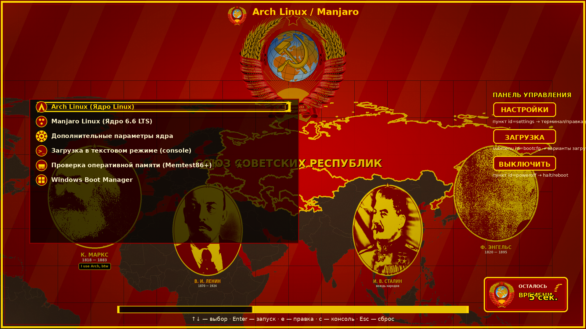
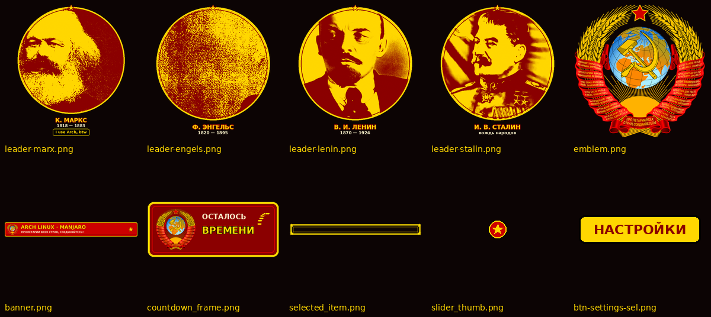

# GRUB-тема «СССР» v2 — красно-золотая, Arch Linux / Manjaro

Тема оформления загрузчика GRUB в эстетике СССР 1930–1950-х: конструктивизм и
социалистический реализм. Палитра: **#CC0000** красный · **#FFD700** золотой ·
**#8B0000** тёмно-красный · **#000000** чёрный. Интерфейс — на русском языке,
заголовок дистрибутивов — на английском («Arch Linux / Manjaro»).

## Что нового в v2

| Изменение | Детали |
|---|---|
| 🗺️ **Фон — настоящая карта мира** | Вектор Natural Earth 1:50m (public domain), спроецирован поверх красного знамени с лучами; территория **СССР (15 республик) выделена алым #CC0000 с золотой обводкой**, подпись «СОЮЗ СОВЕТСКИХ РЕСПУБЛИК», звезда на Москве |
| 👴 **Добавлен К. Маркс** | Реальное фото (`assets/sources/marks.jpg`), дуотонный медальон + плашка **«I use Arch, btw»** у портрета |
| ✌️ **Добавлен Ф. Энгельс** | Вторая половина того же составного фото классиков |
| ❌ **Троцкий удалён** | Убран из фона, ассетов и всех упоминаний |
| 🔠 **Заголовок на английском** | `title-text: "Arch Linux / Manjaro"` — без русскоязычных примесей; остальное (подсказки, таймер, кнопки) — по-русски |
| 🎛️ **Рабочие кнопки панели управления** | «НАСТРОЙКИ / ЗАГРУЗКА / ВЫКЛЮЧИТЬ / ПЕРЕЗАГРУЗИТЬ» — настоящие пункты меню grub.cfg (см. ниже), не картинка |
| 🖼️ **Разрешения** | Канон 1920×1080 + отдельные PNG для 1366×768, 1280×720, 2560×1440, 3840×2160 |

Портреты: **Маркс, Энгельс, Ленин, Сталин** — реальные фотографии в агитплакатной
дуотонной обработке (тёмно-красные тени → золото, зерно, виньетка, золотые
медальоны со звездами). Герб СССР — официальный (Wikimedia Commons,
общественное достояние): как водяной знак на фоне, иконка заголовка и плашка таймера.

## 📸 Как это выглядит



Все ассеты темы на одном листе (портреты, кнопки, герб, рамки):



## Как посмотреть, как это выглядит

1. **Мок-ап (без установки)** — точная имитация экрана GRUB по координатам theme.txt:
   - `theme/previews/mockup-1920x1080.png` (и `preview-1920x1080.jpg`)
   - `theme/previews/assets-contact-sheet.png` — все ассеты на одном листе
2. **QEMU без перезагрузки машины** (рекомендуется):
   ```bash
   qemu-system-x86_64 -enable-kvm -m 512 \
     -drive format=raw,file=/dev/null \
     -kernel /boot/grub/x86_64-efi/grub.efi   # или grub-mkimage-сборка
   ```
   Проще: `grub-mkrescue -o grub-sssr.iso theme/ extra/` и запустить ISO в QEMU/VirtualBox.
3. **Установка на свой ПК** (см. следующий раздел) + перезагрузка.

## Установка

### Быстрый способ (скрипт)
```bash
sudo ./scripts/install.sh
```
Он: копирует тему в `/boot/grub/themes/sssr`, прописывает `GRUB_THEME=` и
`GRUB_GFXMODE=1920x1080,...` в `/etc/default/grub`, добавляет рабочие
кнопки-пункты в `/etc/grub.d/40_custom` и перегенерирует конфиг.

### Вручную (Arch Linux)
```bash
sudo mkdir -p /boot/grub/themes
sudo cp -r theme /boot/grub/themes/sssr
sudo nano /etc/default/grub        # добавить строку:
#   GRUB_THEME=/boot/grub/themes/sssr/theme.txt
sudo grub-mkconfig -o /boot/grub/grub.cfg
```

### Вручную (Manjaro)
```bash
sudo mkdir -p /boot/grub/themes
sudo cp -r theme /boot/grub/themes/sssr
sudo nano /etc/default/grub        # GRUB_THEME=/boot/grub/themes/sssr/theme.txt
sudo update-grub                   # оболочка над grub-mkconfig
```

### Рабочие кнопки (Настройки / Загрузка / Выключить)
В GRUB кликабельными могут быть только пункты меню — Enter на пункте выполняет
действие. Скрипт `install.sh` добавляет в `/etc/grub.d/40_custom`:
```
menuentry 'НАСТРОЙКИ — консоль GRUB (правка)' --id=sssr-settings { terminal_input console ; terminal_output console }
submenu 'ЗАГРУЗКА — дополнительные варианты' --id=sssr-bootcfg { ... }
menuentry 'ВЫКЛЮЧИТЬ компьютер' --id=sssr-poweroff { halt }
menuentry 'ПЕРЕЗАГРУЗИТЬ компьютер' --id=sssr-reboot { reboot }
```
Иконки пунктов: `icons/settings.png`, `icons/gear.png`, `icons/uefi.png`.
Плашки `btn-*.png` / `btn-*-sel.png` — визуальный стиль кнопок (нормальный/выбранный).

## Структура темы

```
theme/
├── theme.txt                    # конфигурация (проверено grub-script-check)
├── background.png               # 1920x1080: карта мира + СССР + вожди + герб
├── background-{1366x768,1280x720,2560x1440,3840x2160}.png
├── emblem.png                   # Госгерб СССР 1956–1991 (реальный файл)
├── leader-marx.png              # К. Маркс (+ «I use Arch, btw»)
├── leader-engels.png            # Ф. Энгельс
├── leader-lenin.png             # В. И. Ленин
├── leader-stalin.png            # И. В. Сталин
├── banner.png countdown_frame.png selected_item.png slider_bg.png slider_thumb.png
├── progress_bar.png progress_highlight.png
├── btn-{settings,boot,power}.png  +  btn-*-sel.png
├── icons/                       # arch, manjaro, star, gear, terminal, memtest, windows, uefi, settings, emblem-64
├── fonts/dejavu-sans-16.pf2, dejavu-sans-18.pf2   # полная кириллица
└── previews/                    # мок-апы и контактный лист
```

## Замена фото своими

```bash
cp moje_marx.jpg    assets/sources/marks.jpg      # составное или одиночное фото
cp moje_lenin.jpg   assets/sources/lenin.jpg
cp moje_stalin.webp assets/sources/stalin.webp
python3 scripts/rebuild_v2.py                     # пересобрать ВСЕ ассеты
python3 scripts/make_mockup.py                    # обновить предпросмотр
```
`rebuild_v2.py` сам докачает недостающие исходники (герб, карту, ссылки выше).

## Шрифты с кириллицей (.pf2 из TTF)

```bash
# штатным инструментом GRUB (входит в пакет grub-common / grub):
grub-mkfont -o theme/fonts/dejavu-sans-16.pf2 --size=16 /usr/share/fonts/TTF/DejaVuSans.ttf
grub-mkfont -o theme/fonts/dejavu-sans-18.pf2 --size=18 /usr/share/fonts/TTF/DejaVuSans.ttf
```
Инструменты: `grub-mkfont` (официальный), GUI-обёртки **GrubCustomizer** /
**Grub2 Editor**; проверка синтаксиса темы — `grub-script-check theme/theme.txt`;
валидация конфига — `grub-editenv list`. Альтернативные шрифты с кириллицей:
Liberation Sans, Noto Sans.

## Отладка

| Симптом | Решение |
|---|---|
| Тема не появилась | В логе `grub-mkconfig` ищите «Found theme»; проверьте права `chmod -R a+rX /boot/grub/themes/sssr` |
| Чёрный экран | GRUB собран без `gfxterm` — установите полный пакет `grub` (не `grub-minimal`); проверьте `GRUB_GFXMODE` |
| Кракозябры вместо кириллицы | Подмените `.pf2`: `grub-mkfont` с DejaVu Sans (в комплекте есть готовые) |
| Разрешение не то | GRUB выбирает ближайший режим из `GRUB_GFXMODE`; приложите вариант `background-WxH.png` |
| Полупрозрачность игнорируется | Старые сборки не читают альфа-канал `bg_color="#000000AA"` — будет сплошной чёрный |

## Лицензии материалов
- Герб СССР (Wikimedia Commons) — public domain.
- Фото Маркса/Энгельса, Ленина, Сталина — предоставлены пользователем (исторические, PD).
- Карта — Natural Earth (public domain).
- Код темы — GPL-3.0 (как и GRUB).
